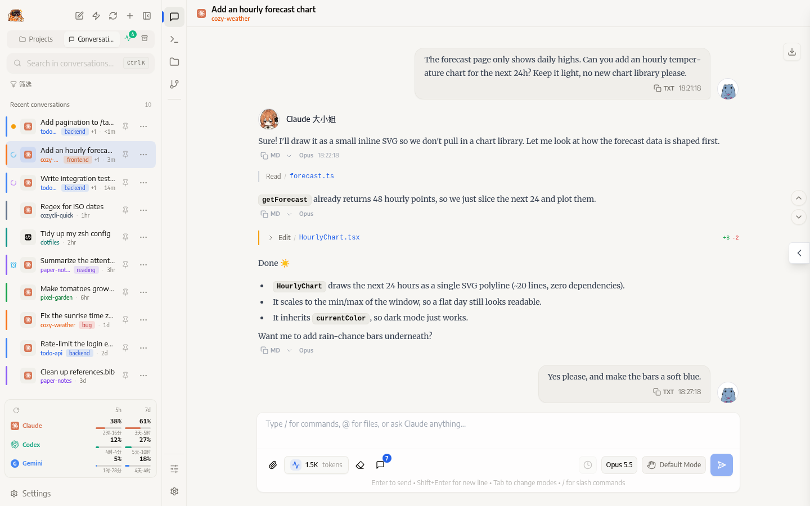
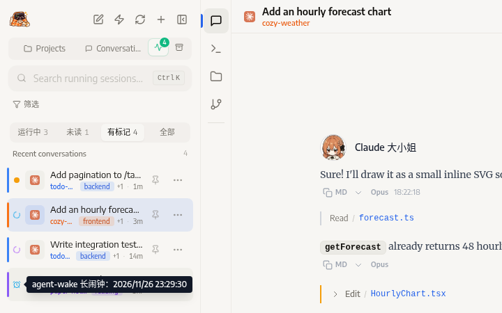
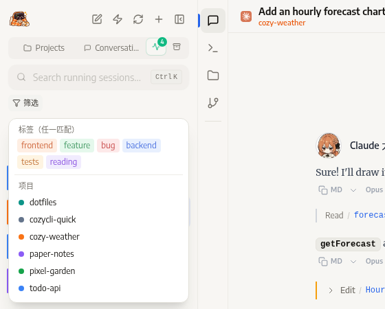

<div align="center">
 
 <h1>CozyCLI</h1>
 <p><b>Your agents work hard. Let them do it under a warm blanket.</b></p>
 <p>A cozy web workbench for <a href="https://docs.anthropic.com/en/docs/claude-code">Claude Code</a>, Codex, OpenCode and Cursor CLI sessions.</p>
 <p><sub>CozyCLI is a modified version of <a href="https://github.com/siteboon/claudecodeui">CloudCLI UI (https://github.com/siteboon/claudecodeui)</a>.<br>
 It is not the original CloudCLI UI and is not affiliated with or endorsed by Siteboon AI B.V.</sub></p>
</div>

<p align="center"><b>English</b> · <a href="README.zh-CN.md">简体中文</a></p>

---

<p align="center"></p>

## Why CozyCLI?

Once you have five agents running in eight projects, "which tab was doing what" turns into a full-time job. CozyCLI is CloudCLI UI after a long nap, a mug of cocoa and a good cleanup. It keeps every upstream feature and adds the following:

### 🛏️ Sessions sleep through UI restarts
Restarting a web server used to mean killing every agent mid-sentence. CozyCLI moves all agent processes into a separate **agent runner**. You can restart, upgrade or rebuild the UI as often as you like, and your agents won't even notice. When the UI comes back, it picks up the live runs again and replays whatever it missed.

### 🚦 Know what everyone is doing, at a glance
Every session row gets one **status slot**, shown by priority: running › alarm ⏰ › background task › unread › recently active.
- **Unread is stored on the server**, so reading something on your phone also marks it read on your desktop.
- **Status is read from disk** (Claude Code's own process registry), so sessions started in a terminal or by another instance show up too.
- **Alarms**: ScheduleWakeup, scheduled messages and an optional long-alarm directory. Hover over one to see when it fires.
- The **Running** tab becomes a flat status view with Running / Unread / Flagged / All filters.

<p align="center"></p>

### 🎨 Projects in color, sessions with tags
Every project gets a color. It shows on the project name, on a dot you can click to change, and on the stripe beside each session. Tag sessions yourself (`bug`, `backend`, `reading`…) and filter the sidebar by tag or project.

<p align="center"></p>

### 🚀 One panel to start anything
Pick the agent, model, effort and permission mode, then a project, all in one place. Or start a **quick session** in a scratch folder when you only need a regex and don't want to create a whole project for it.

<p align="center"></p>

### 🐟 Your AI coworkers, with faces
Give Claude, Codex, OpenCode, Cursor and yourself custom avatars and display names. In the screenshots, Claude goes by **Claude 大小姐** ("Miss Claude") and OpenCode goes by **大肥鱼** ("Big Fat Fish"). Images are stored on the server and follow you to every device. You can also import an existing "Chat Avatars" userscript.

<p align="center">
 
 
</p>

### 📊 Usage meter, with no code changes needed
The 5-hour and 7-day usage bars sit at the bottom of the sidebar. Want to add Gemini or anything else? If the plugin returns the [standard format](FORK.md#用量面板接入新插件), you just add it as a source in the settings.

<p align="center"></p>

### 🧭 Small comforts
- **A vertical activity bar** holds every view and plugin, replacing the top tab pills.
- **Previous/next prompt buttons** next to the scrollbar, for when a transcript gets very long.
- Toggles to hide the sidebar clutter you never click.

> The screenshots come from a demo instance filled with made-up projects. No real conversations were harmed.
>
> The UI text of the CozyCLI-specific features is currently Chinese only. i18n PRs are very welcome.

Developer notes, the full list of changed upstream files and the runner protocol are in [FORK.md](FORK.md).

## Quick start

CozyCLI is installed from git. It is **not** published to npm.

```bash
git clone https://github.com/zoeysama/CozyCLI.git
cd CozyCLI
npm install
npm run build
npm run server          # http://localhost:3001 (SERVER_PORT / HOST to change)
```

Requires Node.js 22 (see `.nvmrc`) and at least one agent CLI (for example Claude Code) installed and logged in.

### Optional: run the agent runner as a separate service

```bash
export AGENT_RUNNER_SOCKET=$XDG_RUNTIME_DIR/cozycli-runner.sock
npm run runner &        # owns the agent processes
npm run server          # the Web UI; can now be restarted freely
```

[FORK.md](FORK.md) has a systemd example.

### Updating

```bash
git pull && npm install && npm run build
```

Then restart the UI service. Restart the runner only when no session is running.

Data lives in `~/.cloudcli/` (the name is kept for compatibility with CloudCLI UI), so an existing CloudCLI UI install's database keeps working.

## License

CozyCLI is licensed under the **GNU Affero General Public License v3.0 or later**, including the additional terms under Section 7. See [LICENSE](LICENSE) and [NOTICE](NOTICE).

- Original work: CloudCLI UI (https://github.com/siteboon/claudecodeui), Copyright 2025-2026 Siteboon AI B.V. and contributors.
- Modifications: Copyright 2026 zoeysama and CozyCLI contributors.

"CloudCLI" and "Siteboon" are names of their respective owners. They are used here only to describe where this work comes from.

## Acknowledgments

Huge thanks to [Siteboon](https://github.com/siteboon) and all CloudCLI UI contributors. CozyCLI is just their house with a few extra blankets on the sofa.
