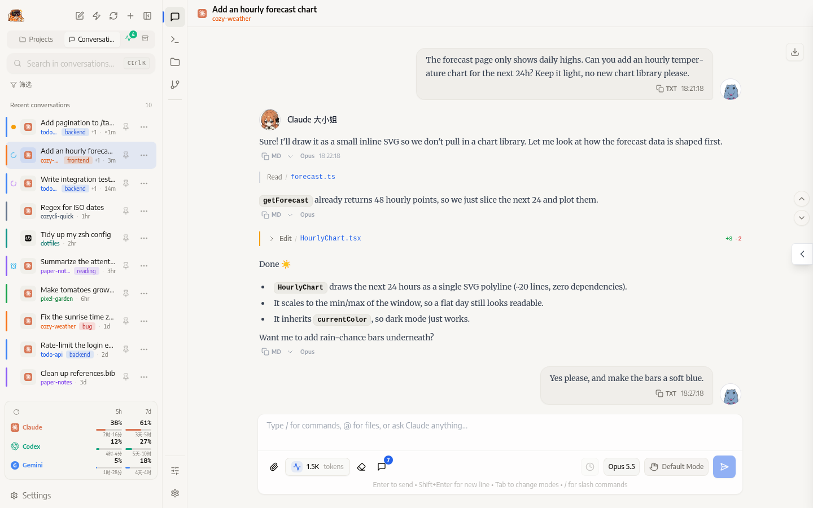
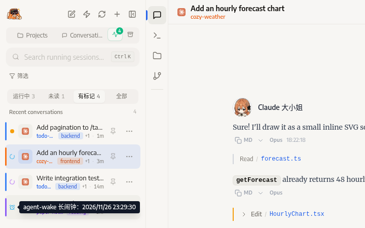
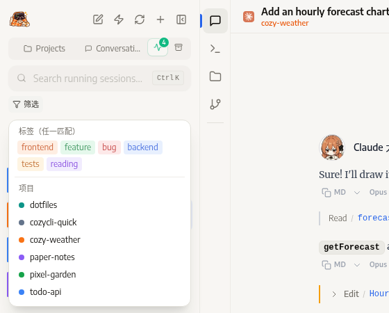
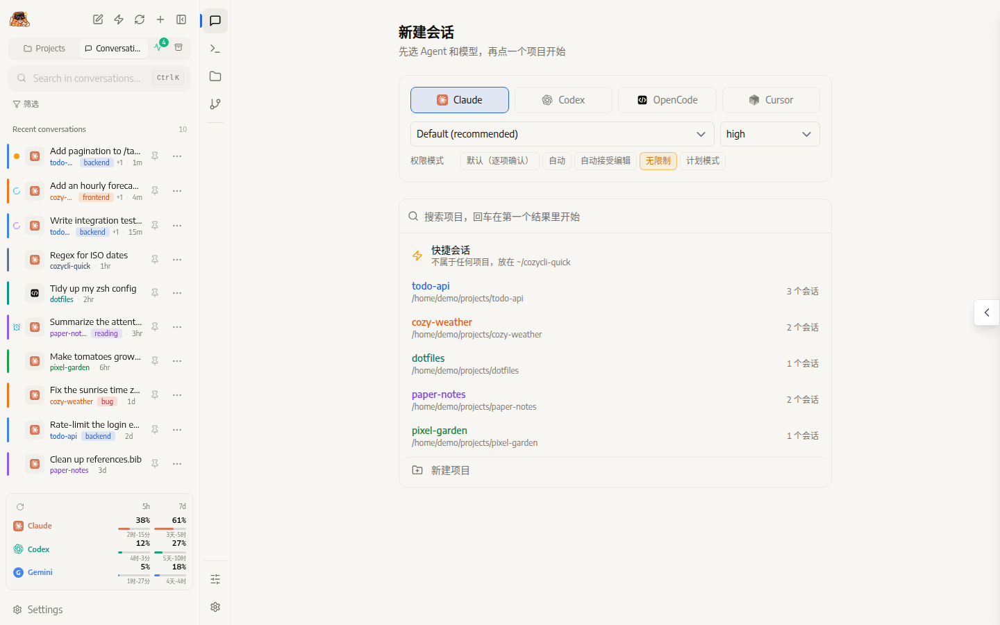
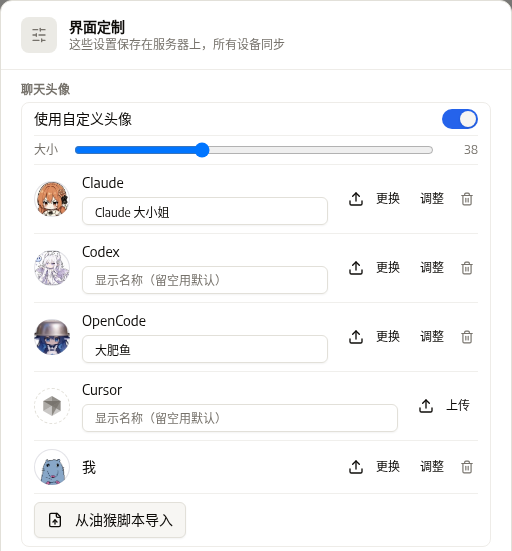
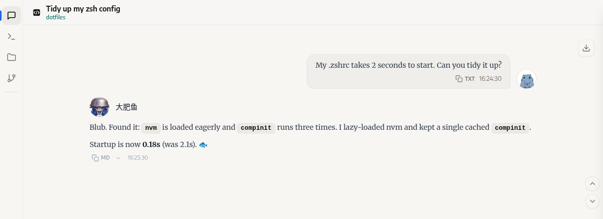
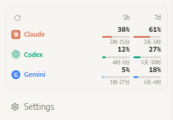

<div align="center">
 
 <h1>CozyCLI</h1>
 <p><b>你的 agent 们已经够辛苦了，至少让它们裹着毯子干活。</b></p>
 <p>一个舒服的 Web 工作台，用来管理 <a href="https://docs.anthropic.com/en/docs/claude-code">Claude Code</a>、Codex、OpenCode 和 Cursor CLI 的会话。</p>
 <p><sub>CozyCLI 是 <a href="https://github.com/siteboon/claudecodeui">CloudCLI UI (https://github.com/siteboon/claudecodeui)</a> 的修改版。<br>
 它不是原版 CloudCLI UI，和 Siteboon AI B.V. 没有关联，也没有得到其背书。</sub></p>
</div>

<p align="center"><a href="README.md">English</a> · <b>简体中文</b></p>

---

<p align="center"></p>

## 为什么要用 CozyCLI？

当你有 5 个 agent 同时在 8 个项目里跑，"哪个标签页在干什么"本身就成了一份全职工作。CozyCLI 就是 CloudCLI UI 睡了个好觉、喝了杯热可可、再好好收拾了一遍之后的样子：上游功能一个不少，在此之上增加了下面这些：

### 🛏️ UI 重启，会话照样睡得香
以前重启一下 Web 服务，所有 agent 都会话说到一半被掐断。CozyCLI 把所有 agent 进程挪进了独立的 **agent runner**。UI 想重启就重启，想升级就升级，想重新构建就重新构建，agent 们根本感觉不到。UI 回来后会重新接上还在跑的会话，并补发错过的事件。

### 🚦 一眼看清谁在干什么
每一行会话都有一个**状态槽**，按优先级只显示一个状态：运行中 › 闹钟 ⏰ › 后台任务 › 未读 › 最近活动。
- **未读状态存在服务端**：在手机上看过，电脑上也会变成已读。
- **运行状态直接读磁盘**（Claude Code 自己的进程登记），所以从终端或其他实例启动的会话也能显示。
- **闹钟**：ScheduleWakeup、定时消息，以及可选的长闹钟目录。鼠标悬停就能看到什么时候响。
- **Running** 标签变成平铺的状态视图，可以按 运行中 / 未读 / 有标记 / 全部 筛选。

<p align="center"></p>

### 🎨 项目有颜色，会话有标签
每个项目都有自己的颜色：项目名会上色，前面的小圆点点一下就能换色，会话旁边的竖条也是这个颜色。会话可以手动打标签（`bug`、`backend`、`reading`……），侧边栏能按标签或项目筛选。

<p align="center"></p>

### 🚀 一个面板开启一切
在同一个地方选好 agent、模型、effort 和权限模式，再选项目就能开始。如果只是想问个正则表达式，用不着为此专门建个项目，直接在临时目录开一个**快捷会话**就行。

<p align="center"></p>

### 🐟 给 AI 同事们换上脸
可以给 Claude、Codex、OpenCode、Cursor 和你自己分别设置头像和显示名称。截图里 Claude 叫 **Claude 大小姐**，OpenCode 叫 **大肥鱼**。图片存在服务端，换个设备也还在。原来的 "Chat Avatars" 油猴脚本也可以直接导入。

<p align="center">
 
 
</p>

### 📊 用量面板，不用改代码
侧边栏底部直接显示 5 小时和 7 天的用量条。想接入 Gemini 或别的模型？只要插件按[标准格式](FORK.md#用量面板接入新插件)返回数据，在设置里添加一个来源就行。

<p align="center"></p>

### 🧭 一些小舒适
- **竖向活动栏**：所有视图和插件都放在左侧竖栏里，替代顶部的标签栏。
- **上一个/下一个提问按钮**：在滚动条旁边，对话很长的时候特别好用。
- 侧边栏里那些从来不点的东西，都可以用开关藏起来。

> 截图来自一个填满虚构项目的演示实例，没有任何真实对话受到伤害。
>
> CozyCLI 新增功能的界面文字目前只有中文，非常欢迎提交 i18n 的 PR。

开发者文档、改动过的上游文件清单和 runner 协议见 [FORK.md](FORK.md)。

## 快速开始

CozyCLI 从 git 安装，**没有**发布到 npm。

```bash
git clone https://github.com/zoeysama/CozyCLI.git
cd CozyCLI
npm install
npm run build
npm run server          # http://localhost:3001（用 SERVER_PORT / HOST 修改）
```

需要 Node.js 22（见 `.nvmrc`），并且至少装好一个 agent CLI（比如 Claude Code）并登录。

### 可选：把 agent runner 作为单独的服务运行

```bash
export AGENT_RUNNER_SOCKET=$XDG_RUNTIME_DIR/cozycli-runner.sock
npm run runner &        # 持有所有 agent 进程
npm run server          # Web UI，现在可以随便重启了
```

systemd 配置示例见 [FORK.md](FORK.md)。

### 更新

```bash
git pull && npm install && npm run build
```

然后重启 UI 服务。runner 只在没有会话运行时才重启。

数据存放在 `~/.cloudcli/`（为了和 CloudCLI UI 兼容，保留了这个名字），所以已有的 CloudCLI UI 数据库可以直接继续用。

## 许可证

CozyCLI 采用 **GNU Affero General Public License v3.0 or later** 许可证，并包含第 7 条的附加条款，见 [LICENSE](LICENSE) 和 [NOTICE](NOTICE)。

- 原作品：CloudCLI UI (https://github.com/siteboon/claudecodeui)，Copyright 2025-2026 Siteboon AI B.V. and contributors。
- 修改部分：Copyright 2026 zoeysama and CozyCLI contributors。

"CloudCLI" 和 "Siteboon" 是其各自所有者的名称，这里只用于说明本作品的来源。

## 致谢

非常感谢 [Siteboon](https://github.com/siteboon) 和所有 CloudCLI UI 贡献者。CozyCLI 只是在他们盖好的房子里，往沙发上多铺了几条毯子。
